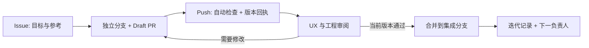

# Inventory — UX iteration workflow / 团队协作流程

GitHub 是需求、实现、UX 验收和交接的共同入口。聊天可以讨论，但结论与证据回到同一个 Issue 和 PR。
本次流程配置不包含当前本地正在制作的 Shop / Tiimo 界面，也不提交其他尚未合并的应用改动。

## 共同流程



| 状态 | 需要完成 | 下一步负责人 |
| --- | --- | --- |
| Ready | Issue 有用户目标、精确参考、范围和验收步骤 | 实现者 |
| In progress | 小分支、Draft PR、迭代记录 | 实现者 |
| Review | 同版本截图/录屏、检查回执、未完成项 | UX reviewer + integration reviewer |
| Changes requested | Reviewer 写明页面、状态、差异、验收办法 | 实现者 |
| Accepted | 最新代码检查通过、UX 范围获认可；外部阻塞另列 | 有写权限的维护者 |
| Merged | 合并提交可追溯，Issue 关闭或拆出剩余任务 | 下一项负责人 |

不必先建立 GitHub Project 看板才能开始。可用 Issues、Draft PR、Request review 和合并状态运行；后续看板沿用上述状态。

## 每次版本如何同步

- **代码**：开发者 commit 并 push 后，同一个 PR 自动更新；本地未提交或未 push 的修改不会自动出现在 GitHub。
- **自动检查**：每次分支 push、PR 更新或手动运行触发 `Iteration checks`。API 构建/测试、iOS 模拟器构建/测试分别显示结果。
- **版本回执**：Actions Summary 与 `iteration-<run-id>-<attempt>` artifact 记录仓库、来源 SHA、实际测试 SHA、PR、运行链接、检查结果。PR 的测试 SHA 常是 GitHub 临时合并提交，因此两种 SHA 分开保存。
- **视觉证据**：负责人把对比图、录屏链接与其对应的来源 SHA 填进 PR 和迭代记录。截图不会从开发者电脑自动上传；新提交改变了界面就更新证据。
- **持久记录**：每个版本保留 `docs/iterations/UX-<issue-number>.md`，在索引加入一行。文件随代码合并，能在历史提交中回看。
- **阶段版本**：维护者在验收后的合并提交创建版本 tag / GitHub Release。标签本身不会部署 App、安装到手机或发布 Marketplace。

被整体取消或 runner 启动失败的运行可能没有回执，需查看 Actions 状态并重跑。Actions artifact 保留 30 天；永久验收结论留在仓库文件与 PR。CI 日志也受仓库保留策略影响。
本流程不会自动 commit 本地修改、替人打勾、合并 PR、发布商品或部署生产。

## 三人的职责

| 角色 | 负责内容 | 提交什么证据 |
| --- | --- | --- |
| UX / 产品负责人 | 选择参考、确定用户流程、核对视觉和动画、决定本轮是否接受 | 参考链接、同尺寸对比、录屏、review |
| App 实现者 | SwiftUI 页面、交互、状态、API 显示 | 代码、设备/视口、主流程与失败状态演示 |
| API / 集成负责人 | API 契约、存储、重复提交、真实模型/市场调用 | 自动检查、真实调用状态与来源、阻塞和下一步 |

同一人可兼任角色，但实现者不能把自己的截图上传等同于独立 UX 验收。
使用 PR 的 **Request review** 指定实际 GitHub 用户；模板中的名字本身不会发送 review 请求。

## UX 验收标准

1. **参考锁定**：精确到 Mobbin screen / flow URL 或图片文件；记录设备尺寸、页面状态和内容差异。
2. **静态对照**：同视口比较字体、字号、行高、间距、圆角、颜色、图标、图片裁切与上下安全区。
3. **动态对照**：记录触发动作、过渡前后、时长/曲线依据、按压反馈、返回与中断、Reduce Motion。只有静态截图时，不宣称测得原版动画。
4. **完整流程**：从入口走到完成；覆盖加载、空数据、错误、重试、成功以及重开后的数据状态。
5. **数据真实性**：明确 real / sample / mocked。生成演示图不能当真实资产或模型识别证据。
6. **独立结论**：`代码检查`、`视觉/动效验收`、`真实 API`、`外部发布`分别记录通过/阻塞/不适用；注明影响本轮验收与否。

对 Inventory 的后续目标流程可按：照片 → 候选物品 → 确认入库 → 价格依据 → 出售草稿。
自动发布只有获得真实平台回执才标记完成；流程配置不表示这些产品功能已经实现或接通。

## 一次性仓库设置（由仓库维护者完成）

当前集成分支：`claude/funny-gauss-ekilg7`。本配置不重命名或修改默认分支；若团队以后改名，更新本文。

- 确认三人的协作邀请已被接受；能读取公开仓库不代表能推送。
- 把本 workflow PR 合并到默认分支，Issue/PR 模板才能按 GitHub 的规则对团队生效。
- 仓库 Actions 必须启用。首次外部分支/贡献者运行可能需要维护者批准。
- 在仓库 ruleset / branch protection 中要求 PR、至少一次 review、解决对话，并在有新提交时撤销旧批准。
- 首次 CI 完整运行后，将 **API checks**、**iOS checks**、**Iteration record** 配置为必需检查。
- 确認 Action runner 可用、macOS 额度适用，且 `macos-15` 有 iOS 17+ runtime；CI 自动选 runner 中的 iPhone，不硬编码某人的本机设备 ID。

这些管理员设置没有通过提交 YAML 自动启用。若当前账号没有管理权限，请维护者完成；不假装已强制执行。

## 实现者操作示例

先保持自己的工作区干净或把未完成工作留在独立分支。不要 reset / clean 队友文件。

```bash
git fetch origin
git switch -c ux/42-scan-review origin/claude/funny-gauss-ekilg7
# 修改代码、补充 docs/iterations/UX-42.md 和截图/录屏链接
git add -- path/to/changed-file docs/iterations/UX-42.md docs/iterations/README.md
git commit -m "Improve scan review flow"
git push -u origin ux/42-scan-review
# 在 GitHub 创建 Draft PR，base 选择团队集成分支；按模板补齐并请求审阅。
```

之后的修订继续 push 同一分支，PR 与检查会更新。不要为了每一轮反馈开一个重复 PR。
维护者可使用 `Closes #42` 将完成的 Issue 与合并关联；未完成范围拆成新 Issue。

## 当前流程配置的交付边界

本改动只增加协作文件与 CI；自动化不需要 Gemini/eBay/发布凭据，也不读取它们。
本地验证通过只说明配置/辅助脚本已检查；首次 GitHub Actions 完整执行、权限设置和 UX 审阅仍是独立验收项。

官方规则：[Actions 工作流](https://docs.github.com/en/actions/reference/workflows-and-actions/workflow-syntax)、[PR 模板](https://docs.github.com/en/communities/using-templates-to-encourage-useful-issues-and-pull-requests/creating-a-pull-request-template-for-your-repository)、[artifact 保留与查看](https://docs.github.com/en/actions/tutorials/store-and-share-data)。
